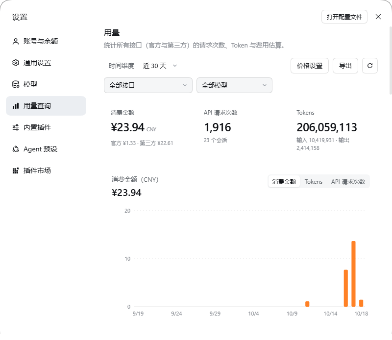
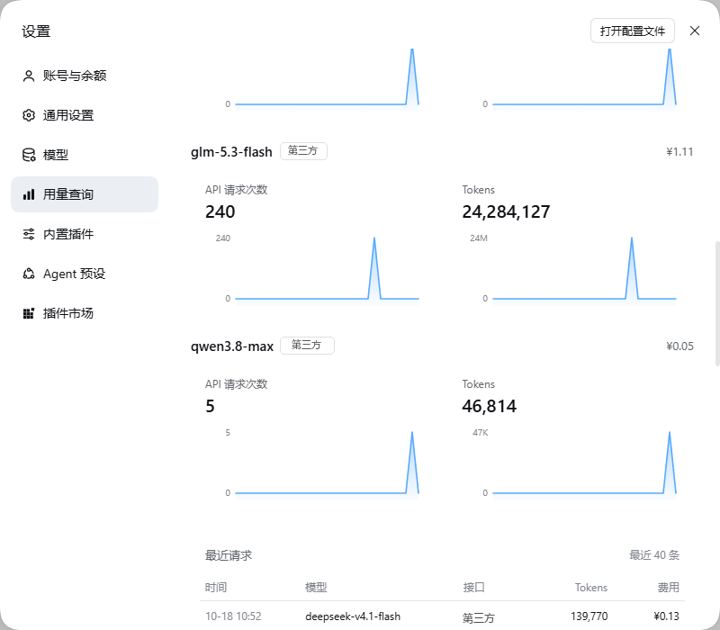

# dsh-usage-insights · 用量查询

给 DSH（DeepSeek Harness）设置加一页「用量查询」：把**官方接口和第三方接口**的每一次模型调用都记下来，按天、按模型、按接口汇总请求次数、Token 与费用估算。

界面照 DeepSeek 官方用量页做的：三张统计卡、橙色消费柱状图、按模型的蓝色面积图，外加最近请求明细和单价编辑。





## 功能

- **全量记录**：对话（turn）、上下文压缩（compaction）、会话标题（title）三类模型调用都计入。
- **官方 + 第三方**：按 provider 归类（如 `deepseek-account` 为官方，`your-relay-a` 之类的第三方接口单独归类），可一键筛选。
- **历史回填**：安装后自动扫描 `$DSH_HOME/sessions` 下已有的会话日志，把历史用量补进账本；之后只读新增部分，增量很便宜。
- **费用估算**：内置 DeepSeek Flash / Pro 价目，官方模型按北京时间峰谷价（工作日 9–12、14–18 双倍）计算；其他模型默认按 Flash 价估算，页面标注「预估」。
- **单价可改**：页面内「价格设置」按模型改「缓存命中 / 未命中输入 / 输出」三项单价（元 / 百万 tokens），改完立即重算历史。
- **导出 CSV**：按当前时间范围 / 接口 / 模型导出逐条明细，带 BOM，Excel 直接打开。
- **只在本地**：账本存在 `$DSH_HOME/storages/dsh-usage-insights/`，不联网、不上传任何数据，也不读消息正文。

## 安装

```bash
dsh plugin --profile desktop add link:/path/to/dsh-usage-insights
```

然后在 DSH 里打开「插件市场 → 已安装」，启用 `dsh-usage-insights`，刷新页面即可在设置侧栏看到「用量查询」。

也可以热挂载（无需重启）：

```bash
curl -X POST http://127.0.0.1:<port>/dsh-market/toggle \
  -H 'content-type: application/json' \
  -d '{"name":"dsh-usage-insights","enabled":true}'
```

## 使用

1. 打开 **设置 → 用量查询**。
2. 顶部选时间维度（近 7 / 30 / 90 天、全部），第二行选接口和模型。
3. 三张卡看总额；柱状图在「消费金额 / Tokens / API 请求次数」之间切换。
4. 「按模型」看每个模型的请求数、Token 与日曲线。
5. 「价格设置」改单价；「导出」下载 CSV；右上角 ⟳ 立即重扫历史。

## 计费口径

- 费用 = 缓存命中 tokens × 命中价 +（未命中输入 + 缓存写入）× 输入价 + 输出 tokens × 输出价，单位元 / 百万 tokens。
- 内置价目（元 / 百万 tokens）：

  | 模型 | 缓存命中 | 未命中输入 | 输出 |
  | --- | --- | --- | --- |
  | DeepSeek Flash | 0.02 | 1 | 4 |
  | DeepSeek Pro | 0.15 | 4.5 | 13.5 |

- 官方 DeepSeek 模型按北京时间（UTC+8，无夏令时）判定峰时，峰时单价翻倍。
- 未知模型按 DeepSeek Flash 价估算。

## 数据

| 文件 | 内容 |
| --- | --- |
| `storages/dsh-usage-insights/events.jsonl` | 每次调用的账本（追加写，按 id 去重） |
| `storages/dsh-usage-insights/pricing.json` | 用户自定义单价 |
| `storages/dsh-usage-insights/backfill.json` | 历史回填游标（文件大小 + mtime） |

账本记录形如：

```json
{"id":"<sessionId>#<seq>","ts":1760000000000,"provider":"deepseek-account","model":"deepseek-flash","input":1000,"output":500,"cacheRead":20000,"cacheWrite":0,"total":21500,"kind":"turn","sid":"...","seq":12}
```

不记录 prompt、回复内容、工具调用参数，也不记录 API Key。

## HTTP 接口

均挂在 `http://127.0.0.1:<port>` 下，供设置页调用，也可自己 curl：

- `GET /dsh-usage/api/v1/summary?days=30&provider=all&model=all`
- `GET /dsh-usage/api/v1/pricing`
- `POST /dsh-usage/api/v1/pricing` `{ "model": "deepseek-flash", "hit": 0.02, "miss": 1, "out": 4 }`，`{ "reset": true }` 恢复默认
- `GET /dsh-usage/api/v1/export?days=30` → CSV
- `POST /dsh-usage/api/v1/backfill` → 重新扫描历史

> 这些接口和 DSH 其他本地接口一样不做登录校验，`POST` 只校验同源。别把 GUI 端口暴露到公网或局域网。

## 结构

```
dsh-usage-insights/
├── index.js            # Host：事件采集、回填调度、路由挂载
├── client.js           # Client：设置页 + 侧栏图标
├── cordis.patch.yml    # 纯 insert，可被插件市场热挂载
├── lib/
│   ├── paths.js        # DSH_HOME / 存储目录
│   ├── ledger.js       # 账本读写、去重、容量上限
│   ├── pricing.js      # 价目表、峰时判定、费用计算
│   ├── sessions.js     # 多帧 zstd 会话日志解析 + 增量回填
│   └── aggregate.js    # 汇总：区间、序列、按模型/接口、最近请求
├── docs/               # 截图
└── package.json
```

## 兼容性

- DSH 0.2.x（Desktop / Web）
- 会话日志为多帧 zstd；解析器逐帧处理，遇到损坏帧跳过而不中断整体回填

## License

MIT
